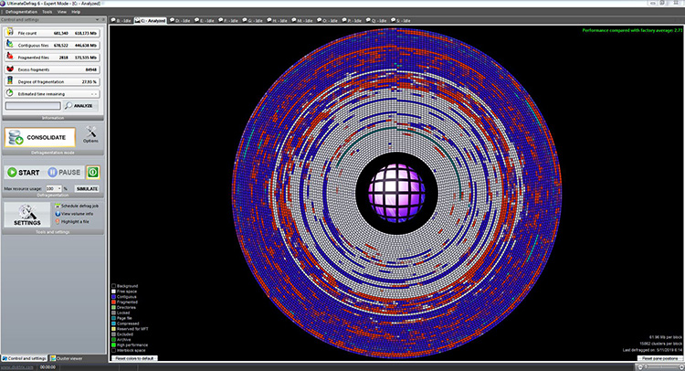

# UltimateDefrag for HDD Defragmentation and File Placement

UltimateDefrag is DiskTrix's utility for defragmentation and file placement on Windows volumes.
UltimateDefrag 6 combines a graphical disk view with several file arrangement methods.
The ultimate defrag 6 workflow starts with identifying the target volume and reviewing its layout.
For disktrix ultimatedefrag 6, method selection should reflect the files and storage hardware involved.
An ultimatedefrag hdd defragmenter review should consider both fragmentation and the workload being measured.

[](https://ultimatedefrag.github.io/UltimateDefrag-6/)

This independent overview accompanies selected CrystalDiskInfo reference files.
Those files belong to a separate disk information application and do not contain UltimateDefrag source code.
The supplied snapshot is incomplete and cannot establish a complete build of either product.

## Overview

UltimateDefrag addresses file fragmentation and the placement of files within a volume.
On a mechanical hard drive, file access involves physical movement and data transfer.
Its placement methods let users distinguish frequently needed files from less active material.

Disk analysis, drive health inspection, and file relocation answer different questions.
A fragmentation report describes file layout.
A health report concerns the drive and its reported condition.
Neither report alone predicts how quickly a particular application will run.

The included CrystalDiskInfo application references are:

- [DiskInfo.cpp](DiskInfo.cpp), which contains application initialization code.
- [DiskInfo.h](DiskInfo.h), which declares application-level definitions.

These references support comparison with a diagnostic utility, not a defragmentation engine.

## Major features

Choose a method according to the result you want to inspect or achieve.
Avoid treating every method as interchangeable.

| Capability | Purpose | Review point |
| --- | --- | --- |
| Cluster Viewer | Inspect clusters and associated files | Confirm the selected volume and file path |
| Fragmented Files Only | Focus on fragmented files | Compare the analysis before and after |
| Consolidate | Rearrange files and free space | Account for the amount of data moved |
| Folder/File Name ordering | Arrange files by directory and name | Relate ordering to a specific workload |
| High Performance selection | Prioritize selected files for placement | Keep the selection aligned with actual use |
| Archive selection | Separate less frequently needed material | Review the files included in that category |
| Simulation | Preview a defragmentation operation | Distinguish a simulation from completed changes |

A useful comparison keeps the workload consistent.
Record which application or file operation you measured.
Note whether the result came from a warm cache or a fresh run.

- Identify the physical storage device behind the volume.
- Check the file system before selecting advanced options.
- Review the fragmented files rather than only a summary percentage.
- Keep frequently changing files in mind when comparing layouts.
- Record the chosen method with the resulting report.


The supplied reference files illustrate a separate volume identification task:

- [EnumVolumeDrive.cpp](EnumVolumeDrive.cpp) contains Windows volume and device enumeration code.
- [EnumVolumeDrive.h](EnumVolumeDrive.h) declares related enumeration functions.

## Sorted optimization

File ordering is most useful when it serves a recognizable access pattern.
A collection of active project files has a different usage pattern from an archive.
Use the application's selection controls to describe those groups deliberately.

An arrangement based on file names may place related directory contents together.
A usage-based selection instead depends on which files you expect to need.
Review the chosen criteria before assuming that a file belongs in a particular zone.

- Keep working documents separate from rarely opened archives.
- Revisit selections after a large application update.
- Account for files that grow or change frequently.
- Compare the same workload when assessing a different arrangement.

Mechanical placement concepts do not transfer directly to solid-state storage.
SSDs do not have faster outer tracks.
DiskTrix states that its HDD placement methods do not improve SSD performance.

The CrystalDiskInfo interface references show how another disk utility organizes its display:

- [DHtmlMainDialog.cpp](DHtmlMainDialog.cpp) implements shared HTML dialog behavior.
- [DHtmlMainDialog.h](DHtmlMainDialog.h) declares the corresponding dialog interface.
- [DHtmlDialogEx.h](DHtmlDialogEx.h) declares additional dialog support.

These files do not implement UltimateDefrag's Cluster Viewer or placement algorithms.



## UltimateDefrag Command Line

UltimateDefrag 6 documents query, analyze, defrag, and simulate actions.
The action determines whether the operation reports information or performs relocation.
Specify the action explicitly so the intended operation is clear.

This PowerShell example assumes the installed UltimateDefrag.exe is discoverable on PATH.
Replace D: with the intended local volume before using it.
The example requests volume information and fragmentation analysis.

```powershell
$targetVolume = "D:"
& UltimateDefrag.exe query $targetVolume
& UltimateDefrag.exe analyze $targetVolume
```

These commands belong to UltimateDefrag, not CrystalDiskInfo.
The supplied source snapshot does not include the UltimateDefrag executable.
Consult the installed help or product manual for the complete method and display options.

## Compatibility

DiskTrix lists Windows Vista through Windows 11, including 32-bit and 64-bit editions.
Its requirements page also lists Windows Server support.
Check the product requirements against the particular system and version you intend to use.

The documented file systems include NTFS and FAT32.
Some advanced functions are unavailable on FAT32.
External drive processing also depends on the connection and storage hardware involved.

For RAID volumes, a visible Windows volume does not guarantee a simple mapping to physical disk tracks.
Controller behavior can affect the relationship between logical clusters and physical placement.
For SSDs, evaluate the documented SSD-specific behavior separately from HDD layout strategies.

The supplied [CompileOptions.h](CompileOptions.h) defines CrystalDiskInfo compile-time options.
Its flags do not describe UltimateDefrag platform support or licensing.

## Building

The reference snapshot contains selected CrystalDiskInfo headers and implementation files.
It omits the solution, several referenced headers, and additional application resources.
It therefore provides material for inspection rather than a complete build procedure.

Supporting headers in the supplied library include:

- [stdafx.h](Library/stdafx.h), which defines common compilation settings and includes.
- [Resource.h](Library/Resource.h), which defines application resource identifiers.
- [resourceS.h](Library/resourceS.h), which defines identifiers for a resource variant.
- [resourceN.h](Library/resourceN.h), which defines identifiers for another resource variant.
- [AboutDlg.h](AboutDlg.h), which declares an About dialog.

This C++ fragment demonstrates reading a flag from the reference project's compile options.
It belongs in a compatible CrystalDiskInfo development context with the header available.

```cpp
#include "CompileOptions.h"
#ifdef OPTION_TASK_TRAY
constexpr bool trayBuildEnabled = true;
#else
constexpr bool trayBuildEnabled = false;
#endif
```

The fragment reports a compile-time choice through a constant.
It does not configure UltimateDefrag or enable any disk operation.
A complete CrystalDiskInfo checkout is required for application development.

## Resources

Use DiskTrix's manual to check method descriptions and command-line syntax.
Its tutorials provide context for reviewing the graphical interface.
Its requirements page describes supported file systems, storage arrangements, and operating systems.

Additional files in the diagnostic reference snapshot cover logging and service support:

- [EventLog.h](EventLog.h) declares Windows event logging functions.
- [EventMessage.mc](EventMessage.mc) defines event message resources.
- [DnpService.h](DnpService.h) contains Windows service control support.

Those components belong to the supplied CrystalDiskInfo materials.
They do not establish UltimateDefrag scheduling, event logging, or service interfaces.

## Contributors

Improvements to this overview should preserve the distinction between the two applications.
Describe the observed disk behavior before attributing it to a particular algorithm.
Include enough context for another reader to interpret an analysis or comparison.

- State the application version and selected method.
- Identify HDD, SSD, or another storage arrangement.
- Describe the file system and connection type.
- Separate measured results from expected benefits.
- Preserve the original names and nested paths of reference files.

## Related Search Terms

UltimateDefrag, UltimateDefrag 6, ultimate defrag 6, disktrix ultimatedefrag 6, ultimatedefrag hdd defragmenter, windows, defragmentation, disk-optimization, file-placement, ntfs, fat32, hdd, ssd, storage, disk-analysis
